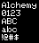
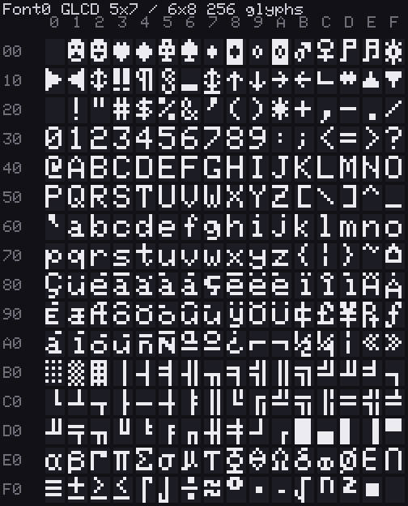

# cardputer-adv-template

Minimal [ESP-IDF](https://docs.espressif.com/projects/esp-idf/) starter for the **M5Stack Cardputer ADV** only.

Fork this for games/apps. It is not a full demo and not a template for the original Cardputer (GPIO matrix keyboard). ADV uses a **TCA8418** over I2C — if keys do nothing, you are on the wrong board.

Hardware: [Cardputer ADV](https://docs.m5stack.com/en/core/Cardputer-Adv) (Stamp-S3A / ESP32-S3, 8 MB flash, 1.14" LCD).

Display: 240 × 135 pixels (1.14″ ST7789V2 IPS).

UI text uses M5GFX / LovyanGFX `fonts::Font0` (Adafruit GLCD 5×7 glyphs in a 6×8 cell):





## Prerequisites (one-time)

Follow Espressif’s [Linux/macOS setup for ESP-IDF v5.4.2](https://docs.espressif.com/projects/esp-idf/en/v5.4.2/esp32s3/get-started/linux-macos-setup.html). Summary for macOS:

### 0. Homebrew

Install [Homebrew](https://brew.sh) if you do not have it:

```bash
/bin/bash -c "$(curl -fsSL https://raw.githubusercontent.com/Homebrew/install/HEAD/install.sh)"
```

Also install Xcode CLT if macOS complains about `xcrun`:

```bash
xcode-select --install
```

### 1. Toolchain packages

```bash
brew install cmake ninja dfu-util ccache
```

`ccache` speeds up rebuilds; project scripts set `IDF_CCACHE_ENABLE=1` automatically. `ninja` is required for the fast watch path.

Optional if `python3` is missing: `brew install python3`.

### 2. Get ESP-IDF v5.4.2

```bash
mkdir -p ~/esp
cd ~/esp
git clone -b v5.4.2 --recursive https://github.com/espressif/esp-idf.git
```

### 3. Install IDF tools

```bash
cd ~/esp/esp-idf
./install.sh esp32s3
```

### 4. Export the environment (every new shell)

```bash
. ~/esp/esp-idf/export.sh
```

You need a USB-C cable and the Cardputer ADV connected for flash/monitor.

If the shell already has IDF exported, `scripts/idf.sh` skips re-sourcing `export.sh` (faster `npm run *` loops).

## One-time project deps (then offline)

Pin and vendor [M5GFX](https://github.com/m5stack/M5GFX) locally (needs Cardputer ADV board support — **0.2.29+**):

```bash
git clone --branch 0.2.33 --depth 1 https://github.com/m5stack/M5GFX.git components/M5GFX
```

After this, builds do not need the network.

## Build & flash

With Node/npm (scripts load ESP-IDF for you):

```bash
npm run deps              # clone M5GFX once into components/
npm run setup             # idf.py set-target esp32s3 (once per checkout)
npm run build             # compile only (idf.py)
npm run flash             # full flash (bootloader + partitions + app) — first bring-up / after partition changes
npm run app-flash         # app image only (day-to-day)
npm run monitor           # serial console only
npm run flash:monitor     # full flash once, then open serial (no watch)
npm run dev:build         # watch main/; ninja rebuild only on save
npm run dev               # watch main/; ninja app-flash on save (no monitor)
npm run menuconfig        # ESP-IDF config UI
npm run clean             # fullclean build tree (use only if build is broken)
npm run bin               # write merged flash image to bins/
```

### Fast edit → live loop

1. `npm run setup` + `npm run build` once per checkout (creates `build/`).
2. `npm run dev:build` until the project compiles cleanly.
3. `npm run dev` to push to the device on each save via [`scripts/fast-build.sh`](scripts/fast-build.sh).
4. Optional second terminal: `npm run monitor`. If monitor already holds the port, flash from it with `Ctrl+T` then `Ctrl+F` instead of running `dev`.

**Why this is fast:** a normal `ninja` rebuild after a one-line edit spends ~4–5s regenerating `sections.ld` (ldgen) even though the linker script did not change, plus ~2s if `export.sh` runs again. `fast-build` compiles `main/`, then **reuses the existing `sections.ld`** and links/elf2images directly (~1.4s vs ~6s measured here). `watch.sh` exports IDF **once** and lets `entr` inherit that env (no re-export per save).

Tweak colors/strings in [`main/theme.cpp`](main/theme.cpp) so you do not recompile M5GFX. Display helpers live in [`main/display.cpp`](main/display.cpp) (PCH’d).

```bash
npm run fast-build          # app .bin only (~1–2s after theme edit)
npm run app-flash           # fast-build + flash @ 921600
npm run app-flash:full      # official idf.py app-flash (runs ldgen)
```

Override baud if needed: `ESPBAUD=460800 npm run dev`. On IDF 5.4+, flash baud is **not** an sdkconfig option — scripts set `ESPBAUD`.

There is no live UI reload. Optional but snappier watches: `brew install entr`.

After `menuconfig` / CMake changes, run a normal `npm run build` once so ldgen refreshes; then `fast-build` / `dev` again.

`flash` / `app-flash` / `monitor` / `flash:monitor` / `dev` auto-pick a USB serial port (`/dev/cu.usbmodem*` on macOS, `/dev/ttyACM*` on Linux) via `scripts/port.sh`. Override with `PORT=…` if needed:

```bash
PORT=/dev/cu.usbmodem14201 npm run dev
```

Prebuilt merged image (bootloader + partition table + app, flash at `0x0`):

- [`bins/cardputer_adv_template.bin`](bins/cardputer_adv_template.bin)

Or call `idf.py` directly after `. ~/esp/esp-idf/export.sh`.

Put the device in download mode if flash fails (hold G0 / reset per Stamp-S3 docs).

## What the sample does

Clears the LCD, waits for one TCA8418 key press, then draws the key code. That proves display + ADV keyboard wiring.

## Layout

```
package.json          # npm run build / flash / dev / …
scripts/idf.sh        # sources ESP-IDF (skips if already exported), runs idf.py @ 921600 baud
scripts/fast-build.sh # incremental build skipping ldgen (used by dev / app-flash)
scripts/port.sh       # auto-detect USB serial port (or $PORT)
scripts/watch.sh      # watch → fast-build for npm run dev / dev:build
bins/                 # merged .bin (flash at 0x0)
CMakeLists.txt
sdkconfig.defaults    # 8 MB flash, USB Serial/JTAG console
main/app_main.cpp     # hello-world + keyboard
main/theme.cpp        # colors/strings (edit here for fast visual tweaks)
main/theme.hpp
main/display.cpp      # M5GFX helpers
main/display.hpp
main/pch_display.hpp  # M5GFX precompiled header for display.cpp
components/M5GFX/     # after clone (gitignored)
```

## Out of scope

Games, audio/IMU, and dropping a merged `.bin` into an installer catalog.

## Credits

- [M5GFX](https://github.com/m5stack/M5GFX)
- [M5Cardputer-UserDemo `CardputerADV`](https://github.com/m5stack/M5Cardputer-UserDemo/tree/CardputerADV) (fetch → `idf.py build` reference)
- TCA8418 keypad controller (I2C)

## License

Released under the [MIT license](LICENSE).

## Colophon

Minimal ESP-IDF starter for the M5Stack Cardputer ADV. Hello world for the LCD and TCA8418 keyboard, with npm scripts for build, flash, and watch. Vibe coded with [Cursor](https://cursor.com).

**Stack**

| Piece | Choice |
|---|---|
| Firmware | [ESP-IDF](https://docs.espressif.com/projects/esp-idf/) v5.4.2 (ESP32-S3) |
| Display | [M5GFX](https://github.com/m5stack/M5GFX) |
| Keyboard | TCA8418 over I2C |
| Tooling | npm scripts + bash (`idf.py` / ninja) |
| Device | [M5Stack Cardputer ADV](https://docs.m5stack.com/en/core/Cardputer-Adv) |

**Tools**

- [ESP-IDF](https://docs.espressif.com/projects/esp-idf/): build / flash / monitor
- [M5GFX](https://github.com/m5stack/M5GFX): LCD
- [Cursor](https://cursor.com): vibe coding

